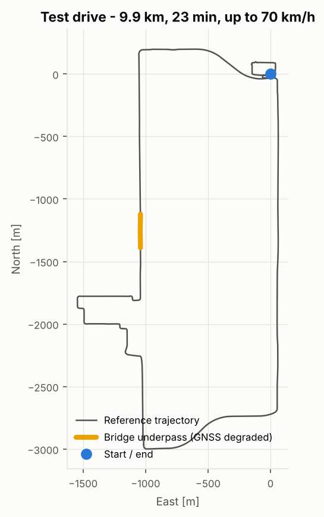
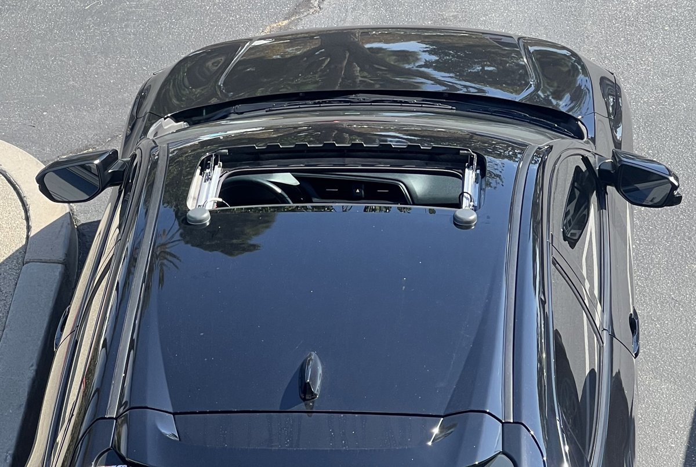
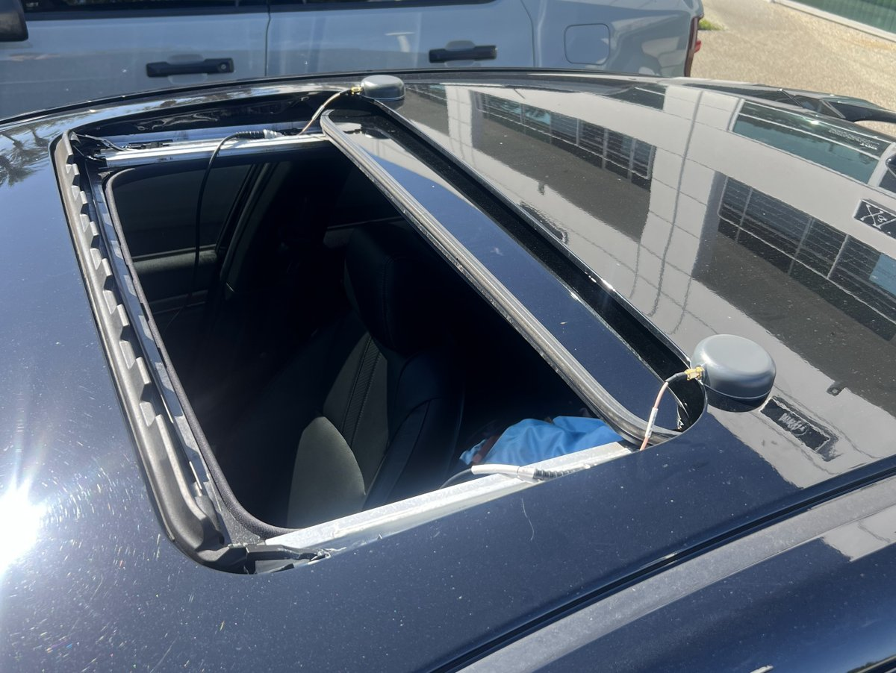
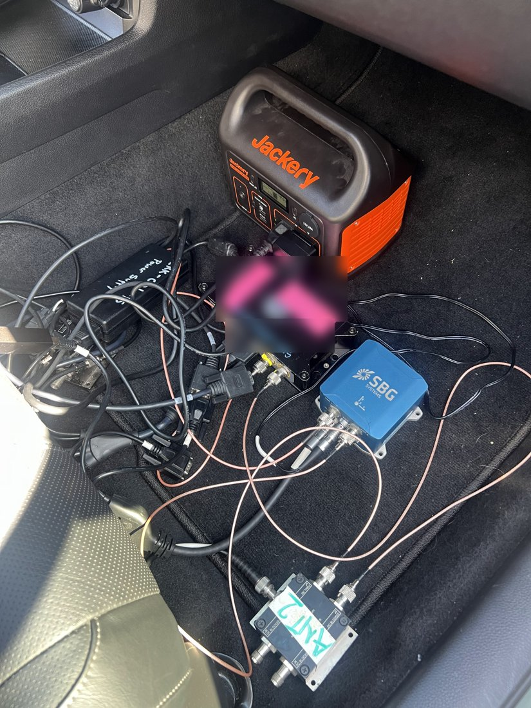
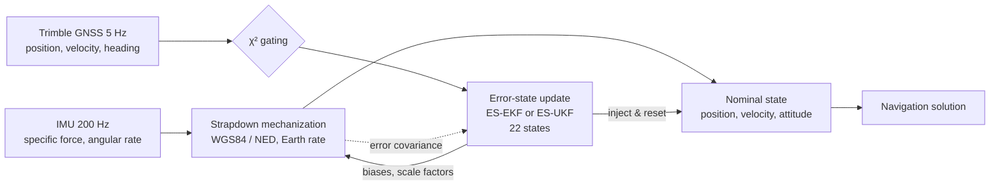
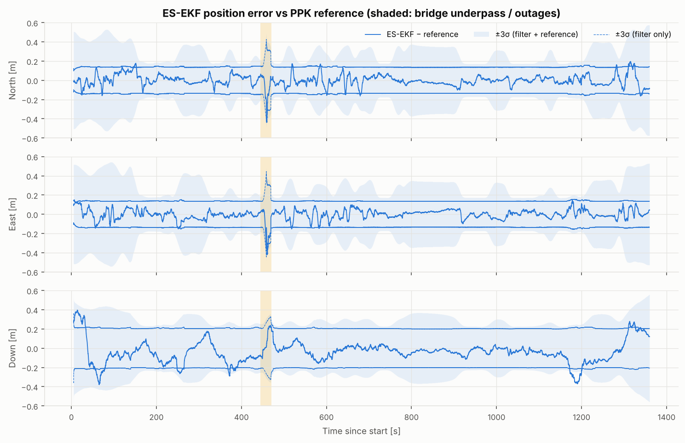
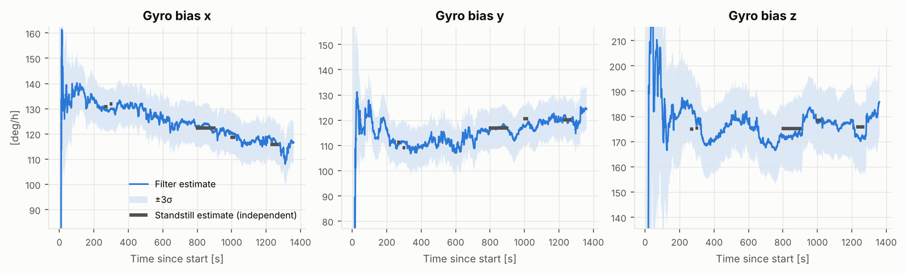
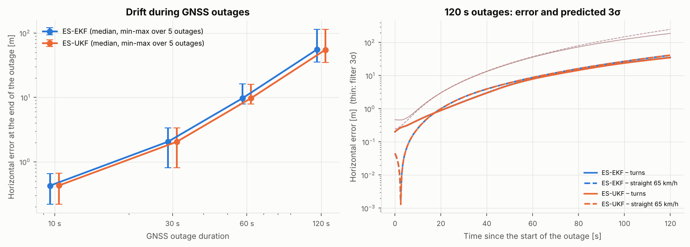
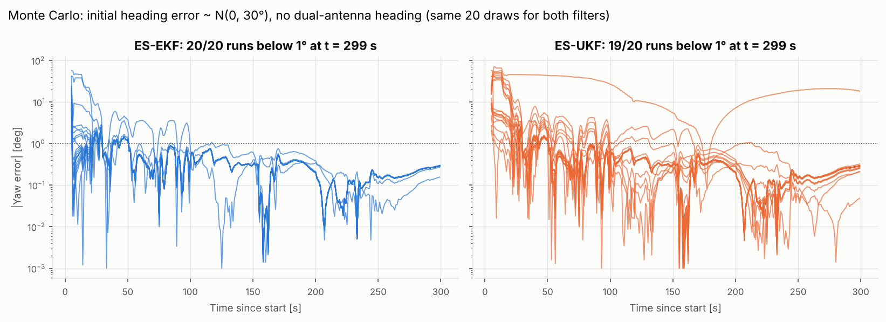

# INS/GNSS fusion on real vehicle data — Error-State EKF vs Error-State UKF

[](https://github.com/COlivier95/ins-gnss-ekf-vs-ukf/actions/workflows/ci.yml)
 

Loosely-coupled fusion of a navigation-grade IMU (SBG Ekinox, 200 Hz) with a dual-antenna Trimble GNSS
receiver (5 Hz), written from scratch in Python. Two estimators share **exactly the same models**:

* an **Error-State Extended Kalman Filter** (ES-EKF), and
* an **Error-State Unscented Kalman Filter** (ES-UKF),

evaluated against a post-processed PPK reference (SBG Qinertia, with its own uncertainty) on a 23-minute
drive, through a real GNSS degradation (bridge underpass), simulated GNSS outages and a Monte Carlo on the
initial heading.



## Highlights

* **7.7 cm horizontal / 0.03° roll-pitch / 0.12° yaw RMS** over the whole drive, and a **consistent**
  filter: 97.5 – 99.9 % of the errors inside ±3σ (filter + reference uncertainty).
* **22-state error model** built from what the data showed: gyro biases and **scale factors**, a
  **time-correlated RTX error** and a **dual-antenna heading error** modelled as colored noise.
* **Data-driven modelling**: gyro turn-on biases and scale factors estimated online, bias variation during the
  warm-up, an EGM96/EGM2008 geoid mismatch, a 2.7 cm antenna height difference — each found, quantified and
  handled.
* **Robustness**: χ² innovation gating (46 wrong GNSS velocities rejected under the bridge) and automatic
  re-acquisition after long outages.
* **Honest comparison**: on this problem the ES-UKF brings no accuracy gain for 3× the CPU, and converges more
  slowly than the ES-EKF from large initial heading errors. The reasons are explained.

## Hardware setup

Data recorded with my own installation on a passenger car:

| Vehicle and dual-antenna baseline | GNSS antennas on the sunroof frame | In-cabin hardware |
|---|---|---|
|  |  |  |

* **IMU**: SBG Systems Ekinox (Ekinox2-ISU), 200 Hz, on the front passenger floor
* **GNSS**: Trimble dual-antenna receiver with RTX corrections, 5 Hz, two puck antennas 0.77 m apart across
  the car, ~1.2 m above the IMU
* **Reference**: SBG Qinertia PPK forward-backward solution with 1σ, at the IMU point
* Lever arms and frames: [`config/system.yaml`](config/system.yaml) — dataset: [`data/README.md`](data/README.md)

## Architecture



Both filters share the nominal state, the 22-state error model, the noise model, the measurement models with
lever arms, the tuning, the exact GNSS time tagging and the gating; only the prediction / update core differs
([`src/insnav/filters`](src/insnav/filters)). Equations: [`docs/theory.md`](docs/theory.md).

## Results — whole drive vs PPK reference

| | Horizontal | Vertical | Roll | Pitch | Yaw | Run time (23 min of data) |
|---|---|---|---|---|---|---|
| **ES-EKF** RMS error | 0.077 m (95 %: 0.143 m) | 0.109 m | 0.030° | 0.019° | 0.120° | 51 s |
| **ES-UKF** RMS error | 0.077 m (95 %: 0.143 m) | 0.110 m | 0.030° | 0.019° | 0.121° | 149 s |
| Errors inside ±3σ (filter + reference) | 99.9 % N / 99.9 % E | 97.8 % | 97.5 % | 98.9 % | 97.7 % | |



As in any INS, the gyro turn-on biases must be estimated by the navigation filter (the raw IMU output is used
here). The filter estimates them from GNSS aiding only and follows the values measured independently on the
five standstills, including their slow change as the IMU warms up from 33 to 38 °C:



## Benchmark — ES-EKF vs ES-UKF

**Simulated GNSS outages** (position, velocity and heading all removed), 10 to 120 s, at the same five epochs
(slow urban driving, mixed, turns, turns with a stop, straight at 65 km/h):



| Outage | Horizontal error at the end (median / worst) | Errors inside ±3σ | ES-EKF vs ES-UKF |
|---|---|---|---|
| 10 s | 0.43 m / 0.66 m | 100 % | identical |
| 30 s | 2.1 m / 3.4 m | 100 % | identical |
| 60 s | 9.7 m / 16 m | 100 % | identical |
| 120 s | 55 m / 114 m | 100 % | identical |

**Monte Carlo on the initial heading**, without the dual-antenna heading (single-antenna case): 20 random
initial heading errors drawn from N(0, 30°), the same draws for both filters:



The ES-EKF converged in 20/20 runs (most of them below 1° within 10 s), the ES-UKF in 19/20 and more slowly.
With α = 1 the sigma points sit at √n ≈ 4.7σ: for a 30° heading σ they sample ±141°, where the dynamics are
strongly nonlinear, and the resulting covariance slows (once prevents) the convergence.

**Take-away.** With a good IMU and GNSS aiding, the error state stays small and the ES-EKF linearisation is
accurate: the ES-UKF costs 3× more CPU for the same accuracy and consistency. The UKF is not automatically
better — for large angular uncertainties the parameterisation matters more than the choice of filter.

## What the data revealed

| Finding | How it was found | Handling |
|---|---|---|
| EGM96 (receiver) vs EGM2008 (reference) geoid | 0.12–0.27 m vertical residual following the model difference | ellipsoidal heights only: bias 0.198 m → < 1 mm |
| Secondary antenna 2.7 cm higher | receiver baseline elevation output | in the lever arms: yaw bias +0.14° → +0.03° |
| Yaw steps of ~0.5° at every 90° turn | 21 turns, sign flipping with the turn direction | gyro scale-factor states: yaw RMS 0.31° → 0.22° |
| RTX error 2.4× its σ, correlated over ~5 s | GNSS − reference residuals | Gauss-Markov error states: ±3σ consistency N/E/D 85/80/79 % → 97/99/93 % |
| Gyro bias variation during the warm-up | five standstills | bias random walk tuned from the data: outage drift within 3σ |
| Filter locked out after a long outage | outage benchmark | position re-acquisition |

The full story, including the bugs the tests caught: [`docs/design_decisions.md`](docs/design_decisions.md).

## Repository layout

```
config/
  system.yaml          lever arms, antenna baseline, reference conventions
  filters.yaml         noise model and tuning (shared by both filters)
data/                  raw IMU / GNSS logs and PPK reference (gzip text), see data/README.md
src/insnav/
  io/                  SBG log readers, common GPS time base
  geodesy/             WGS84, radii, normal gravity, LLA/ECEF/NED, geoid model
  attitude/            quaternions, DCM, Euler angles
  mechanization/       strapdown navigation equations (scalar and batched)
  alignment/           coarse alignment, standstill detection
  models/              22-state error model, GNSS measurement models
  filters/             shared filter loop, ES-EKF, ES-UKF
  evaluation/          errors vs reference, consistency metrics
  plotting/            figure style
scripts/               data checks, mechanization validation, filter runs, benchmark
tests/                 unit tests (geodesy, rotations, mechanization, Jacobians) and filter tests
docs/                  theory notes, design decisions, figures
results/benchmark/     benchmark results (JSON)
```

## Quick start

```bash
pip install -e ".[dev]"
pytest                                       # 26 tests: geodesy, rotations, mechanization, Jacobians, filters

python scripts/explore_data.py               # data checks and figures
python scripts/validate_mechanization.py     # free-inertial drift on the real IMU
python scripts/run_filter.py --filter ekf    # ES-EKF over the drive (--filter ukf for the ES-UKF)
python scripts/benchmark.py outages          # simulated GNSS outages, both filters (~15 min)
python scripts/benchmark.py heading-mc       # Monte Carlo on the initial heading (~15 min)
python scripts/plot_benchmark.py             # benchmark figures and tables
```

## Limitations

A single drive and a loosely-coupled architecture; a small systematic roll offset (0.03°) and the accelerometer
scale factors are not modelled; the forward filters are compared with a forward-backward reference. Some noise
parameters were characterised against the reference (see [design decisions §7](docs/design_decisions.md#7-evaluation)).

## License

MIT — see [LICENSE](LICENSE).
