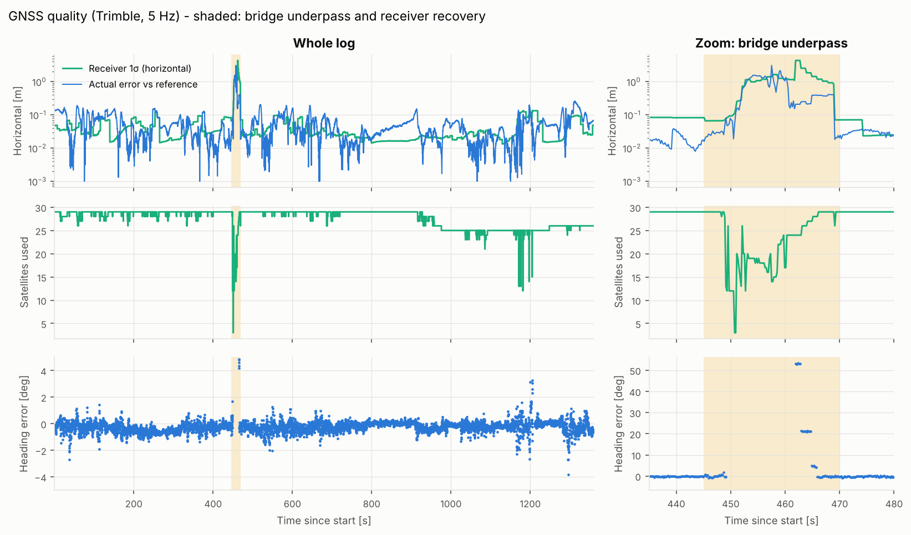
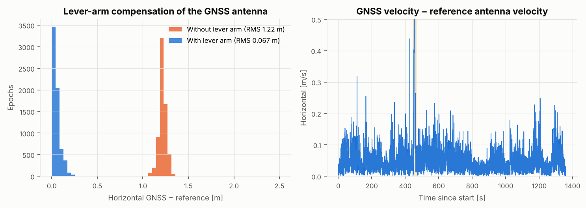

# Dataset

Real automotive acquisition recorded in Orange County, California (Santa Ana area):
**23 min, 9.9 km, speeds up to 70 km/h**, including a bridge underpass.

## Hardware

| Sensor | Model | Rate |
|---|---|---|
| IMU | SBG Systems Ekinox2-ISU (Ekinox-D) | 200 Hz |
| GNSS | Trimble dual-antenna receiver (logged by the INS as `gnss2`) | 5 Hz |
| Reference | SBG Qinertia post-processed PPK INS solution (forward/backward), at the IMU point | 200 Hz |

Mechanical setup (lever arms, frames): see [`config/system.yaml`](../config/system.yaml).

## Files

All files are gzip-compressed text exports (`pandas.read_csv` reads them directly).
Each SBG export has a header line followed by a units line.

| File | Content |
|---|---|
| `raw/imuShort.txt.gz` | device time [us], status, specific force X/Y/Z [m/s²], angular rate X/Y/Z [deg/s], temperature — body frame FRD |
| `raw/gnss2Pos.txt.gz` | device time, status, GPS time of week [ms], latitude/longitude [deg], altitude MSL [m], geoid undulation [m], 1σ N/E/D [m], satellites |
| `raw/gnss2Vel.txt.gz` | device time, status, GPS ToW, velocity N/E/D [m/s] and 1σ, course |
| `raw/gnss2Hdt.txt.gz` | device time, status, GPS ToW, dual-antenna heading and pitch [deg] with 1σ, baseline [m] |
| `raw/gnss2Sat.txt.gz` | satellite tracking summary (1 Hz) |
| `reference/Reference_Trajectory_Ellipsoid_Std.txt.gz` | GPS ToW [s], roll/pitch/yaw [deg], latitude/longitude [deg], WGS84 ellipsoidal height [m], and their 1σ (Qinertia): attitude [deg], position [m] |

## Time base

Everything is converted to **GPS time of week**. GNSS epochs use their `gpsTow` field; the IMU device
timestamps are shifted by the device-to-GPS offset, which is constant to the microsecond over the
whole log (`insnav.io.load_dataset`).

## Data checks (`python scripts/explore_data.py`)

| Check | Result |
|---|---|
| GNSS antenna vs reference, **without** lever arm | 1.22 m horizontal RMS |
| GNSS antenna vs reference, **with** lever arm | **0.067 m** horizontal RMS, vertical bias < 1 mm |
| GNSS velocity vs reference antenna velocity | 0.04 m/s (1σ per axis), no bias |
| Dual-antenna heading − 90° − reference yaw | median −0.23°, robust 1σ 0.34° |
| Bridge underpass (t ≈ 449–470 s) | satellites drop to 3, DGPS fallback with errors up to 3.1 m (correctly flagged by a 3.5 m σ), dual-antenna heading lost for 12.8 s then wrong by up to 53° for 4 s (flagged by the receiver with a 14–30° σ) |

## Reference accuracy

Qinertia reports its own uncertainty: median 1σ of **7.8 / 7.3 / 5.9 cm** (N / E / D, 3.5–18 cm along the drive),
**0.009°** in roll and pitch and **0.033°** in yaw. In position the reference is therefore not a centimetre-level
truth (its σ is comparable to the filter errors), while in attitude it is 3 to 5 times more accurate than the
filters. Filter consistency is evaluated against the combined filter + reference covariance.

## Known systematic effects

These are properties of the setup, documented rather than tuned away:

* **Two different geoids (solved).** The Trimble receiver outputs MSL heights with **EGM96**, while the first
  Qinertia export was in MSL with **EGM2008**. Comparing the two MSL altitudes left a slowly varying vertical
  offset of 0.12 to 0.27 m that followed EGM2008 − EGM96 along the drive. The reference is now exported in
  **WGS84 ellipsoidal height** and all comparisons are made in ellipsoidal heights: the vertical bias between
  GNSS and reference is below 1 mm (0.08 m 1σ, consistent with the RTX vertical accuracy). The loader still
  accepts an MSL export together with its geoid (`config/system.yaml`).
* **Gyro turn-on biases.** The log contains the raw IMU output, so the turn-on gyro biases are present in the
  data and must be estimated by the navigation filter, as in any INS (measured on the five standstills: stable
  over the log, with a slow change of the x/y biases as the IMU warms up from 33 to 38 °C).
* **Scale factors.** The yaw error showed small steps at every turn, with a sign flipping with the turn
  direction: an effective z-gyro scale factor in this raw data set, estimated online by the filter
  (see [`docs/design_decisions.md`](../docs/design_decisions.md)).
* **Dual-antenna baseline**: the two antennas are hand-placed puck antennas on a crowned roof. The receiver's
  baseline elevation output shows the secondary antenna **2.7 cm higher** than the primary (2.0° over 0.77 m);
  this is now part of the lever arms in `config/system.yaml`. Leaving it out biased the filter heading by
  +0.14° on average (0.1–0.3° depending on the vehicle pitch). A residual heading error of ~0.3° (1σ, slowly
  varying) remains: it is the accuracy limit of this hand-placed short baseline.
* **GNSS corrections**: Trimble RTX; the receiver reports these solutions as `RTK_FLOAT` (code 6),
  with a 2–8 cm announced horizontal accuracy.
