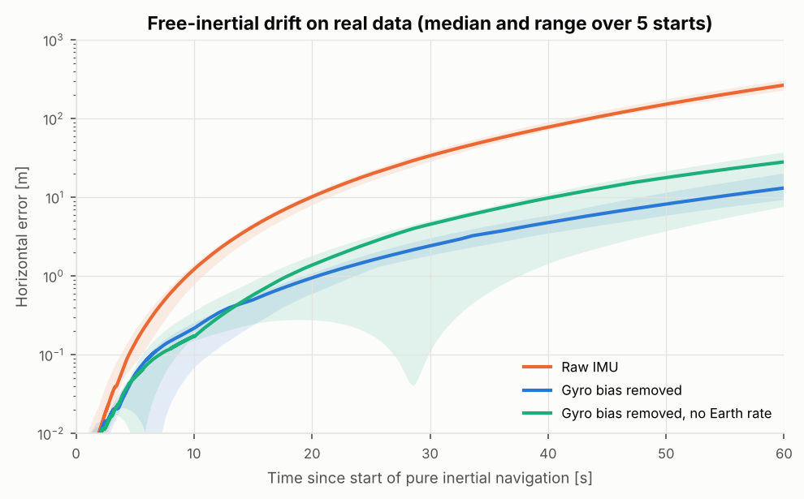

# Design decisions and diagnostics

How the filters got where they are. Each entry follows the same pattern: what was observed, how it was
diagnosed (with numbers), what was decided, and what it changed. Several entries are mistakes that the
tests or the data exposed — they are kept because finding them is part of the work.

---

## 1. Data and frames

**Common time base.** The SBG log carries device timestamps (µs) and, for GNSS, the GPS time of week of the
measurement epoch. The offset between the two is constant to the microsecond over the whole log
(490206.9588 s), so every stream is moved to GPS time; GNSS epochs keep their own `gpsTow` (no latency bias).

**Lever arms.** Hand-measured from the IMU to the antenna reference point. Validation against the reference:
the GNSS − reference horizontal residual drops from **1.22 m to 0.067 m RMS** once the lever arm is applied.

**Two geoids.** Comparing MSL altitudes left a 0.12–0.27 m vertical offset that grew towards the south of the
drive. The Trimble undulation matched **EGM96** (−35.399 m vs −35.406 m at the start) while Qinertia exported
MSL with **EGM2008** (−35.245 m); the difference between the two models followed the residual exactly.
Decision: work in WGS84 ellipsoidal heights only; the reference was re-exported in ellipsoidal height and the
vertical bias fell from **+0.198 m to < 1 mm**.

**Dual-antenna geometry.** The baseline points along +y, so the measured azimuth is yaw + 90°: modelled through
the full baseline vector $C_{nb} b^b$ rather than a fixed offset. The receiver's own baseline elevation output
showed the secondary antenna **2.7 cm higher** (crowned roof); ignoring it biased the yaw by +0.14° on average
(0.1–0.3° depending on the vehicle pitch). Included in the lever arms: mean yaw bias +0.03°.

## 2. Sensor characterisation from the data

**Gyro turn-on bias.** The raw IMU output is used, so the turn-on biases are in the data, as for any INS.
They were measured on the five standstills (reference attitude used only to remove the Earth rate).
Decision: no calibration, the filter estimates the biases from GNSS aiding (initial σ = 200 deg/h). The
standstill values serve as an independent check of the estimates.

**Gyro bias variation during the warm-up.** The IMU warms up from 33 to 38 °C over the drive and the x/y biases
change slowly with it. With 1 deg/h in the model (a constant-temperature value), the filter was overconfident
in GNSS outages (drift growing as $t^3$, mostly cross-track: a tilt error from an unmodelled bias change). Decision: bias instability set from the data (20 deg/h over 3600 s).
Effect: 60 s outage on the straight segment 27 m → 9.7 m, error/σ 3.8 → 0.8.

**Gyro scale factors.** Yaw errors jumped by ~0.5° at every 90° turn. Integrating the gyro over 21 turns against
the reference shows an error proportional to the turn angle, with a sign that flips with the turn direction (a
scale factor, not a bias). Decision: three scale-factor states (initial σ 1 %). The filter estimates the
effective z scale factor of this raw data set within 150 ppm of the turn-integration value; yaw RMS
0.31° → 0.22° at this step.

Pure inertial navigation on the real data (initialised from the reference, 60 s) shows how much the raw biases
matter: 266 m of drift with the raw gyros, 13 m with the gyro bias removed, 28 m when the Earth rotation is
also ignored (`scripts/validate_mechanization.py`):

**IMU noise.** The raw 200 Hz noise at standstill (0.17–0.30 °/s on the gyros) is engine vibration that
averages out: over 1 s it is equivalent to 0.2 deg/√h and 0.04 m/s/√h, the values used (the vehicle
vibrations, not the sensor noise, set this level).

## 3. GNSS measurement noise

**Colored RTX position errors.** First version (15 states, receiver σ): only **58 %** of the errors inside
±3σ. The GNSS − reference residuals are 2.4 times the receiver σ horizontally and strongly time-correlated
(autocorrelation 0.93 after 1 s, 0.49 after 5 s). Treating 5 positions per second as independent makes the
filter believe it averages the noise away: its σ collapsed to 2 cm for 5–7 cm of actual error.
A first fix inflated R by ×4 — it removed the false rejections but did not fix the structure, so it was
replaced by **three Gauss-Markov states** for the GNSS error (τ = 7 s horizontal, 12 s vertical, σ from the
residuals). Position consistency: 85/80/79 % → 97/99/93 % (filter σ only).

**Dual-antenna heading.** Same mechanism with a slower error (misalignment + multipath wander of a few tenths
of a degree over minutes). A random-walk heading-error state halved the yaw RMS (0.20° → 0.10°) and raised
the yaw consistency from 34 % to 91 %.

**GNSS velocity.** The receiver reports 0.03 m/s; the actual noise is 0.04–0.055 m/s. Cross-correlation with
the reference shows no time offset (minimum at 0 ms for position, ~−10 ms for velocity). Decision: σ floor at
0.05 m/s.

## 4. Robustness

**Innovation gating.** χ² test at 0.999 on every measurement. Under the bridge it rejects the 46 wrong GNSS
velocities. The wrong dual-antenna headings after the bridge (up to 53°) are flagged by the receiver itself
with a 14–30° σ: they are accepted with negligible weight (NIS ≈ 2–3), which is the correct behaviour.
(An earlier statement that they came with a small σ was wrong and has been corrected.)

**Lock-out after a long outage.** In the outage benchmark, a 120 s outage ended with 95 m of error for a 36 m
σ; every GNSS fix was then rejected by the gate and the filter never recovered (2.7 km later). Decision:
**re-acquisition** after 10 consecutive position rejections (inflate the position covariance by the squared
innovation, accept the fix). A first version also forced velocities and accepted the bad ones under the bridge
(horizontal RMS 0.075 → 0.26 m); it is now restricted to the position, the absolute anchor.

## 5. Bugs caught by the tests

* **Mid-interval attitude.** The specific force was rotated with an attitude that included the body half
  rotation but not the navigation-frame half rotation. Invisible on real data, but the 10-minute static test
  with perfect IMU signals drifted by 0.26 m. Fixed: the static drift is now < 1 cm.
* **Nominal Gauss-Markov state not propagated.** The covariance of the GNSS-error state decayed but its
  nominal value did not, so the two disagreed: the estimate drifted to 1.9 m (vertical position error 1.2 m).
  Fixed in `propagate_nominal_aux`; biases were switched to random walks for the same reason.
* **Velocity Jacobian with a scale factor.** With $s_g \neq 0$, $\partial\hat\omega / \partial b_g = -(1 - s_g)$,
  not −1 (0.7 % error), found by the finite-difference test.
* **Finite differences.** Position Jacobians cannot be checked with 1 µm steps on latitudes in radians
  (float64 resolution); the tests use per-state steps and central differences.

## 6. Implementation

**One error model, two filters.** The ES-EKF and the ES-UKF share the nominal state, the error state, the noise
model, the measurement models, the tuning, the time handling and the gating (`filters/base.py`); only
`propagate` and `correct` differ. Without this, a comparison measures implementation differences.

**Performance.** Small numpy arrays cost ~0.5 µs per operation: the first mechanization took 570 µs per step.
The strapdown core is written component-wise and runs either on Python floats (9 µs/step, ES-EKF) or on
arrays of sigma points (0.29 ms for 31 points). Whole drive (272 000 IMU samples): ES-EKF 51 s, ES-UKF 149 s.

**UKF time update.** Sigma points are regenerated every 20 IMU samples and before each GNSS update, the IMU
samples in between being buffered and replayed through the mechanization for every point. This keeps the
full nonlinear propagation at a reasonable cost.

**UKF parameters.** α = 1, β = 2, κ = 0: non-negative weights, positive semi-definite covariance by
construction. The price is a large spread (4.7σ). Large initial headings are the case where it matters:
with σ = 150° the points wrap around the circle and neither Gaussian filter is meaningful; within σ ≤ 30°
the Monte Carlo shows the ES-EKF converging faster than the ES-UKF (20/20 vs 19/20). α = 0.5 was tried and
was not better.

## 7. Evaluation

**The reference is not a perfect truth.** Qinertia reports ~8 cm (3.5–18 cm) horizontal, 0.009° roll/pitch,
0.033° yaw. In position its σ is of the same order as the filter errors. Consistency is therefore evaluated
on filter − reference with the combined covariance. In horizontal position the error/σ ratio is 0.53–0.57:
the combined σ is larger than the observed differences, which suggests that the reference σ is conservative.

**What was tuned on the reference.** For transparency: the ×2.4 under-estimation of the RTX σ, the GNSS error
autocorrelations, the velocity noise floor and the gyro scale-factor diagnosis were measured *against the
reference*. A production system would get them from a calibration data set and use a different drive for the
evaluation. The filters themselves never use the reference (autonomous alignment, GNSS + IMU only).

## 8. Known limitations and next steps

* **Roll offset of −0.028°** (≈ 0.5 mrad, ~2σ combined): a systematic effect not in the model. Candidates:
  a residual mounting/frame alignment difference between the raw IMU output and the reference processing.
* **Accelerometer scale factors** are not modelled; they add along-track error during strong accelerations in outages.
* **Loosely coupled**: no use of raw GNSS observables, so no benefit from fewer than four satellites
  (tightly coupled integration would help under the bridge).
* **Forward filter only.** The reference is a forward-backward smoothed solution; a Rauch-Tung-Striebel
  smoother would be the fair comparison for post-processing.
* **A single drive.** Conclusions on EKF vs UKF hold for this sensor grade and this type of trajectory.
* Possible extensions: IMU misalignment and accelerometer scale-factor states, RTS smoother, tightly coupled
  updates, invariant EKF (whose linearisation does not depend on the attitude error), numba acceleration.
